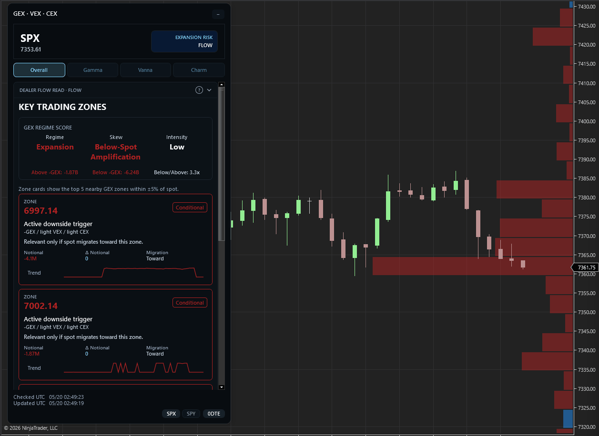

# Gamma Vanna Charm Exposures



NinjaTrader 8 indicator that maps option-chain **Gamma (GEX)**, **Vanna (VEX)**, and **Charm (CEX)** exposure onto futures charts.

The goal is not to predict direction by itself. The goal is to show where dealer hedging may become more active if price, implied volatility, or time moves into important strike zones.

If you are new to dealer hedging concepts, start with the [Dealer Exposure overview](DEALER_EXPOSURE.md).

> **Trade the zones, not the headline.**
>
> GEX explains price-response behavior. VEX flags IV-sensitive hedge context. CEX explains time-decay / clock-pressure relevance.

## Download and install

Minimum NinjaTrader Version: `8.1.6`

Download the latest NinjaTrader import `.zip` from the [GitHub releases page](https://github.com/OrderRejected/gamma-vanna-charm/releases).

Import it in NinjaTrader like any other indicator add-on:

```text
Tools → Import → NinjaScript Add-On...
```

Select the downloaded release `.zip`, then add `_Gamma Vanna Charm Exposures` to a chart.

## What the app shows

- Right-side exposure histogram on the chart. Longer rows mean larger absolute exposure at that mapped strike.
- Floating dashboard/card with tabs:
  - **Overall** — strike-first dealer-flow map.
  - **Gamma** — price-response / suppression-vs-expansion map.
  - **Vanna** — IV-repricing sensitivity map.
  - **Charm** — time-decay / late-session clock-pressure map.
- GEX regime score with regime, skew, intensity, above/below balance, and skew ratio.
- Key zone cards showing:
  - zone / mapped strike
  - role / stack
  - notional
  - change in notional
  - state: Building, Stable, Unwinding, Conditional
  - migration
  - trader read
  - strike-level trend
- `0DTE` / `ALL` expiration scope toggle.
- Flow-implied dealer-position model by default.

## Core idea

Dealer exposure is context, not a standalone signal.

Use the dashboard to answer four questions:

1. **Where are the actionable strike zones?**
2. **What dealer response is expected at each zone?**
3. **Is that response building, stable, unwinding, or conditional?**
4. **Is the zone driven by price, conditioned by IV, affected by time, or all three?**

A clean interpretation:

- **GEX-only zone** = mostly price-led.
- **GEX + VEX zone** = IV-sensitive if IV actually reprices.
- **GEX + CEX zone** = time-sensitive, especially later in the session.
- **GEX + VEX + CEX zone** = stacked response zone.

Wait for price acceptance, rejection, IV behavior, or time-of-day context before using a zone in a trade plan.

## Data and mapping

- Uses CBOE delayed option-chain data.
- CBOE payload timestamp is treated as provider response/update time, not a guaranteed delayed-market as-of timestamp.
- Auto proxy mapping:
  - `ES` / `MES` -> `SPX` by default; `SPY` optional.
  - `NQ` / `MNQ` -> `QQQ`.
- CBOE `current_price` anchors option strikes to the futures chart.
- SPX levels are bucketed in 5-point strikes; SPY/QQQ use 1-point ETF strikes.
- Configurable multipliers map proxy strike distance to futures distance.

## Exposure model

The indicator uses a **flow-implied dealer model**. In the app, **FLOW** is just our shorthand name for that model; it is not a separate data feed and it is not a guarantee of actual dealer inventory.

The model is intentionally simple and inferred from option-chain snapshots:

- The first snapshot seeds a simple signed open-interest baseline: calls positive, puts negative.
- Later snapshots compare poll-to-poll changes in cumulative volume, quote location, IV, and OI.
- Those changes are classified as likely customer buying or selling, then converted into an inferred signed dealer-contract estimate.
- Signed dealer contracts drive GEX/VEX/CEX directly.
- Derived exposure snapshots, levels, dealer states, and classified snapshot intervals are persisted to daily SQLite files under `C:\gvc` by default, e.g. `C:\gvc\20260518.sqlite`.

This is closer in spirit to an implied dealer-position / [DDOI-style](https://squeezemetrics.com/download/The_Implied_Order_Book.pdf) idea than a static open-interest snapshot, but it is not the same thing as tracking every transaction or reconstructing a true order book. It only sees delayed option-chain snapshots and tries to infer changes between them. When snapshot changes line up with real trading activity, the model may better reflect intraday dealer-position changes; when they do not, treat it as a useful proxy, not ground truth.

The position model is fixed inside the indicator and is not a user-editable setting.

## Metric meaning

- **GEX**: hedge exposure for a 1% underlying move.
- **VEX**: hedge exposure for a 1-vol-point IV move.
- **CEX**: hedge exposure for one calendar day of time decay.

CBOE gamma is used when available. Vanna and charm are computed with Black-Scholes.

Sign conventions are most straightforward for gamma. Vanna and especially charm can be reported differently by vendor/model conventions, including whether charm is defined versus calendar time or time-to-expiration. Read VEX and CEX primarily as sensitivity/concentration layers, not fixed bullish/bearish signals.

## How to read each tab

### Overall

Overall is the main trading-plan tab. It is **strike-first**: traders trade levels, not abstract Greek categories.

Overall should answer:

> Where are the key tradable zones, what dealer response is expected there, and is that response building, stable, unwinding, or conditional?

What to focus on:

- **GEX regime score** — tape context before individual zones.
- **Key trading zones** — top nearby GEX zones with same/nearby VEX and CEX context.
- **Role / stack** — whether the zone is GEX-led, IV-sensitive, clock-sensitive, or stacked.
- **State** — whether the zone is gaining, holding, fading, or not active yet.
- **Migration** — whether the exposure center is moving toward, away, flat, higher, or lower.
- **Trader read** — what to expect if price interacts with the zone.

Overall is not trying to say “bullish” or “bearish.” It describes where dealer response may suppress or amplify accepted moves.

### Gamma / GEX

Gamma is the **price-response tab**.

Ask:

> If price moves into this zone, are dealers more likely to fight the move or chase it?

- **Positive GEX** usually suggests dealer hedging may suppress movement around the zone.
  - Possible behavior: chop, pinning, failed breaks, mean reversion.
- **Negative GEX** usually suggests dealer hedging may amplify accepted moves through the zone.
  - Possible behavior: faster continuation after acceptance; avoid blind fades.

### Vanna / VEX

Vanna is the **IV-response tab**.

Ask:

> If implied volatility reprices near this zone, does that add hedge pressure or is the move mostly price-led?

VEX is conditional. It matters most when IV is actually moving.

The dashboard shows an IV condition based on weighted chain IV from current vs prior snapshots:

- **Firming** — IV is rising; VEX may become more relevant.
- **Fading** — IV is falling; VEX context may be fading.
- **Neutral** — no clear IV activation yet.
- **Not Measured** — not enough IV snapshot context yet.

Use VEX as conditional context around a GEX zone, not as a standalone trade signal.

### Charm / CEX

Charm is the **time-decay / clock-pressure tab**.

Ask:

> As time passes, especially later in the session, which zones become more important?

CEX is time-weighted. It usually matters less early and more later in the day, especially on 0DTE / expiration days.

Time weight labels:

- **Light Now** — early session; GEX usually dominates.
- **Moderate** — midday; CEX can matter if spot is near large strikes.
- **High** — late session; clock effects become more relevant.
- **Highest** — final 30 minutes; strike proximity and 0DTE effects matter most.

CEX should be interpreted as potential time-decay hedge sensitivity, not a standalone bullish/bearish signal.

## GEX regime score

The GEX regime score frames the tape before reading individual zones.

| Net GEX Above | Net GEX Below | Regime | Meaning |
|---:|---:|---|---|
| Positive | Positive | Suppression | Dealer hedging may dampen moves on both sides. |
| Negative | Negative | Expansion | Dealer hedging may amplify accepted moves on both sides. |
| Positive | Negative | Split | Suppression above, expansion below. |
| Negative | Positive | Mixed / Unstable | Dealer response differs by side; confirmation matters. |

### Skew

Skew compares the absolute size of below-spot exposure to above-spot exposure.

```text
Skew ratio = larger absolute side / smaller absolute side
```

Labels:

- `< 1.5x` = Balanced Response
- `>= 1.5x` = Above-Spot or Below-Spot response dominance

Skew color comes from the **sign of the dominant side’s net exposure**:

- positive dominant side = that metric’s positive color
- negative dominant side = that metric’s negative color
- balanced = neutral

### Intensity

Intensity compares current absolute exposure against the recent persisted trend window.

Current implementation uses the same window as dashboard trend:

- last **2 hours**
- up to **60 persisted snapshots**

Labels:

- Low
- Moderate
- High
- Extreme

## Zone states

Zone state is inferred from available dashboard evidence:

- current notional
- change in absolute notional
- strike-level trend slope
- top-strike rotation / rank proxy
- exposure-center migration
- spot distance
- same/nearby VEX/CEX sensitivity

| State | Meaning | Trader use |
|---|---|---|
| Building | Exposure/relevance is increasing. | Zone deserves more respect if price accepts into it. |
| Stable | Exposure is holding steady. | Trade the level normally; require confirmation. |
| Unwinding | Exposure/relevance is fading. | Be careful treating old large strikes as dominant. |
| Conditional | Zone is meaningful but not active yet. | Monitor until spot, IV, or time activates it. |

## Practical trading workflow

### 1. Start with Overall

Find the active strike zones and the current dealer-response map.

Look for:

- building zones near spot
- large notional zones
- zones where migration is moving toward the strike
- same/nearby VEX or CEX sensitivity
- split response above vs below spot

### 2. Check Gamma

Use GEX to decide whether a price interaction is more likely to suppress or amplify.

- **Building negative-GEX zone**: accepted moves may amplify; continuation risk rises.
- **Building positive-GEX zone**: movement may be suppressed; failed breaks or pinning become more important.
- **Mixed / split GEX**: trade level-to-level; confirmation matters more.

### 3. Check Vanna

Use VEX to decide whether IV is adding pressure.

- Strong VEX + IV firming can increase hedge-sensitivity and reaction risk.
- VEX fading means the move may become more price-led.
- Weak VEX means keep GEX primary.

### 4. Check Charm

Use CEX to decide whether time decay makes a zone more important later.

- High CEX near spot late day can increase pin/magnet/clock-pressure behavior.
- CEX early in the session is usually context, not the main driver.
- CEX unwinding means late-day influence may be fading.

### 5. Wait for interaction

The dashboard gives a map. Price still has to interact with the map.

Examples:

- If price accepts below a building negative-GEX zone, avoid blind fades and watch for continuation.
- If price repeatedly fails at a positive-GEX zone, pin/mean-reversion behavior may be more likely.
- If a GEX trigger also has strong VEX context and IV is firming, the zone deserves more respect.
- If spot is near a high-CEX strike into the final hour, watch for pin, magnet, or unwind behavior.
- If a large zone is unwinding, reduce confidence in that old level.
- If a zone is conditional, monitor it as a destination; do not overtrade it early.

## Language and interpretation rules

Avoid reading the dashboard as a direct directional call.

Prefer:

- “Accepted moves below may amplify.”
- “Dealer response may be stronger below spot.”
- “This zone becomes active if spot migrates toward it.”
- “VEX matters only if IV reprices.”
- “CEX matters more into the close.”

Avoid:

- “Bullish” / “bearish” by itself.
- “Dealers are buying” / “dealers are selling.”
- “Downside pressure is heavier.”

## Colors

Signed values use the selected metric’s positive/negative colors:

- Overall uses GEX colors.
- Gamma uses GEX colors.
- Vanna uses VEX colors.
- Charm uses CEX colors.

The tab toggle buttons share one uniform accent color so they read as navigation, not signed exposure.

Neutral labels, such as balanced skew or CEX time weight, use neutral text colors because they are not signed exposure values.

## Key settings

- `Exposure metric`: Overall, Gamma, Vanna, or Charm. Overall uses Gamma for the histogram and synthesizes Vanna/Charm in the card.
- `Use 0DTE options`: today's expiration only, or all returned expirations.
- `Proxy symbol`: Auto, SPX, SPY, QQQ.
- Poll interval, CBOE endpoint, proxy multipliers, histogram colors, and fixed bottom-left card offsets.

## Limitations and risk notes

- This is an options-exposure map, not a trading system.
- CBOE data is delayed and can update on its own provider cadence.
- Dealer books are inferred; actual dealer positioning can differ.
- VEX and CEX sign conventions can vary by vendor/model.
- Historical intensity and trends depend on persisted snapshots being available.
- Always combine the dashboard with price action, liquidity, risk limits, and your own execution plan.
